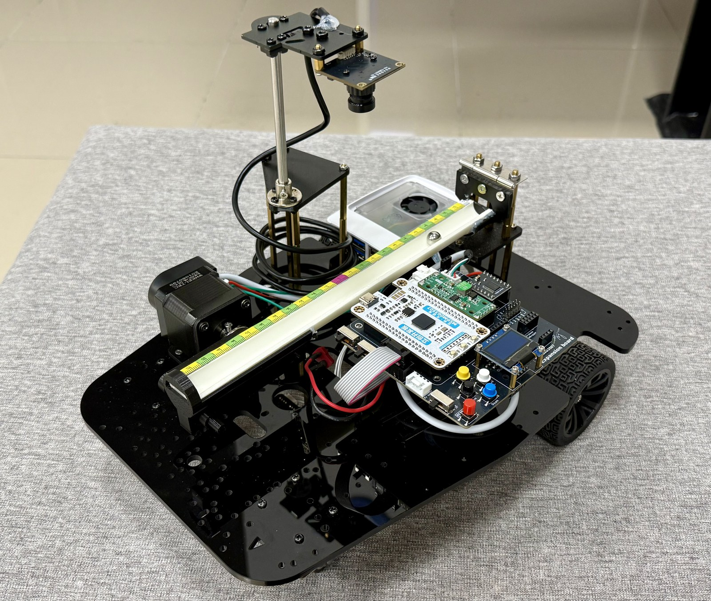
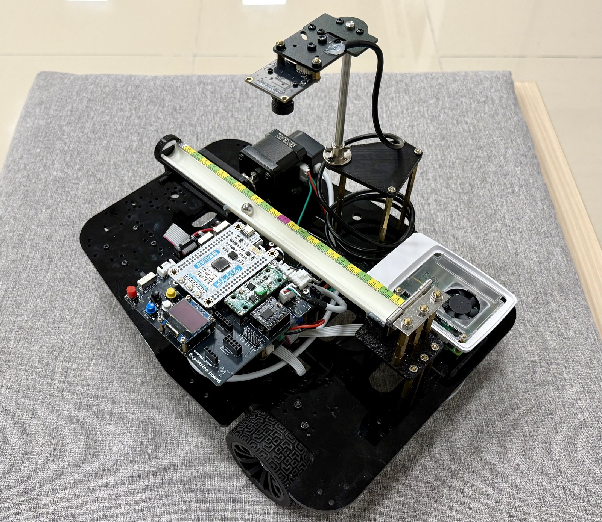
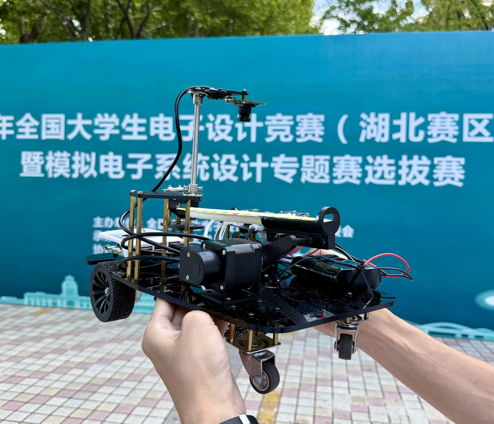
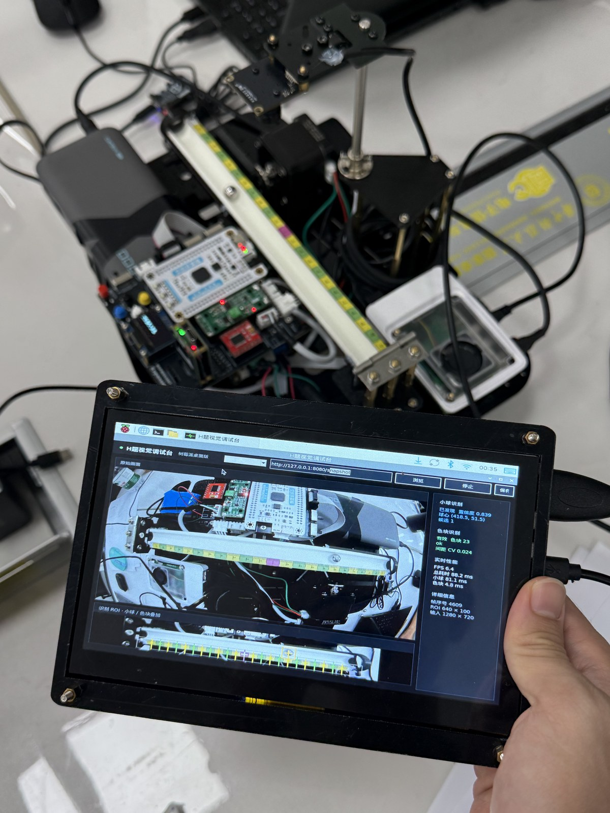
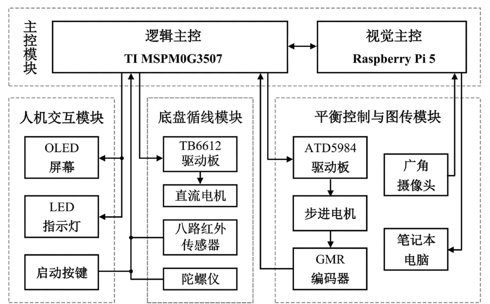
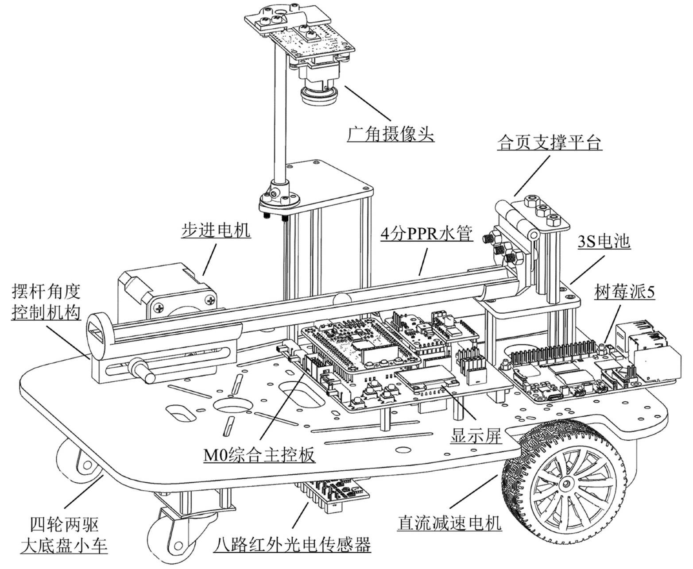
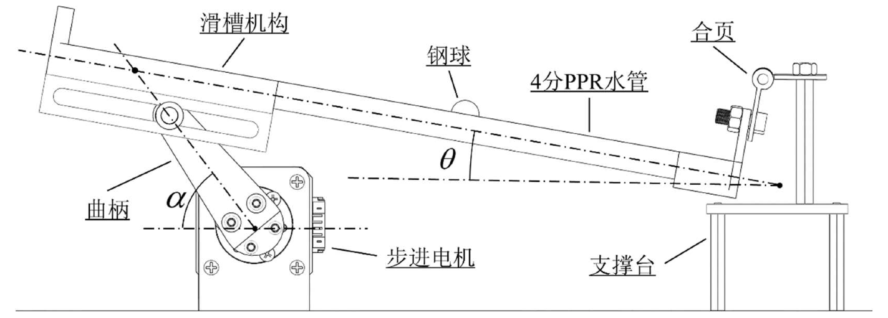
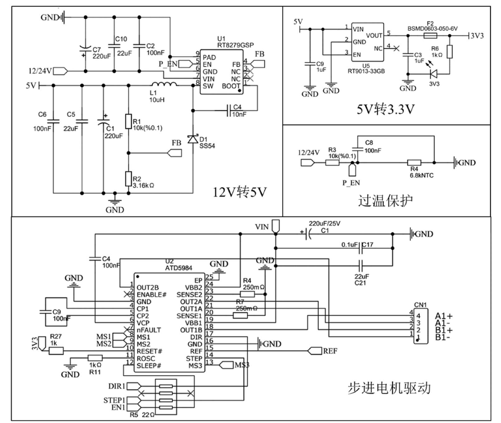
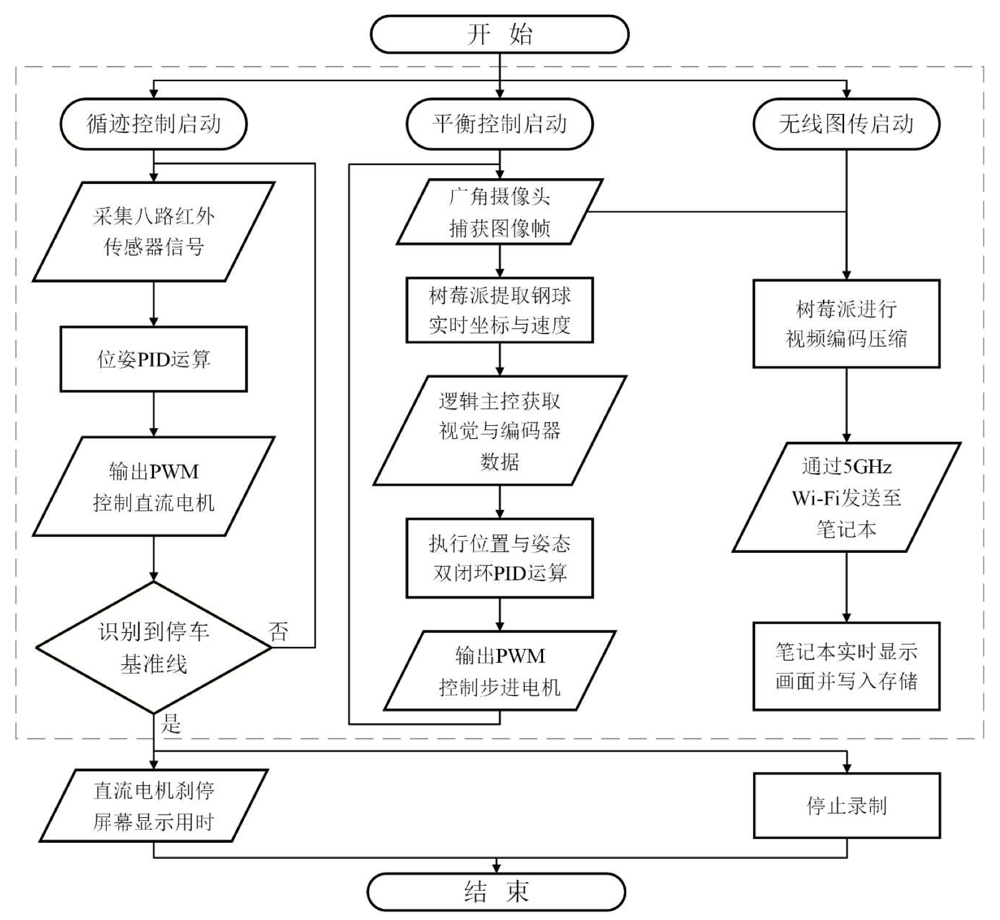
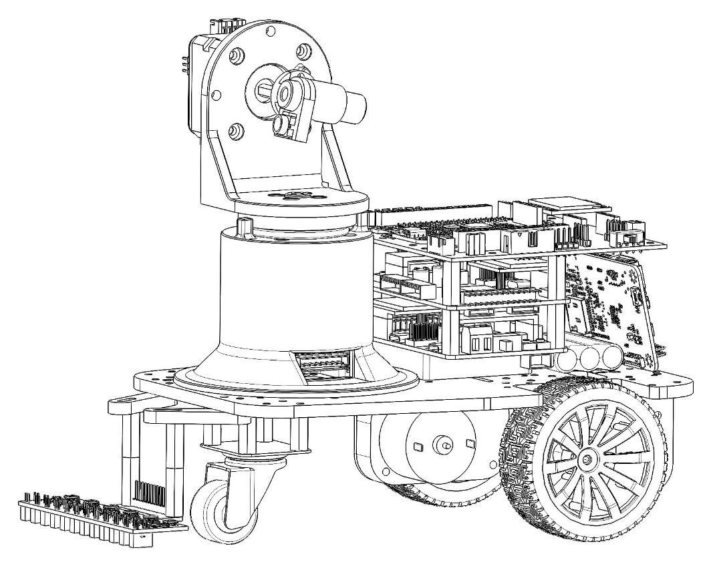

# NUEDC_2026

**全国大学生电子设计竞赛（TI 杯）备赛与作品归档仓库**

以 **2026 年 H 题「车载平衡滚球运动控制系统」** 为主体，完整开源双机协同控制与视觉图传源码、自研主控拓展板、3D 结构模型与设计报告，并沉淀历届校赛/省赛作品、通用 MSPM0 小车底座固件、硬件选型与报告模板。

[2026H 成品展示](#成品与联调展示) · [系统架构与原理](#系统总体方案与原理) · [实测指标](#实测结果) · [仓库结构](#仓库目录结构) · [往届赛题](#往届赛题沉淀) · [开发环境](#构建与开发环境)

---

> **团队成员**：王佳宁、彭嘉亮、陈煦栋  
> **仓库地址**：<https://github.com/VincentttWang/NUEDC_2026>

---

## 成品与联调展示

<table>
  <tr>
    <td align="center" width="50%">
      
       
      <b>图 1｜2026H 整机外观</b>：彩色刻度摆杆、广角摄像头立架、G3507 主控板与树莓派 5
    </td>
    <td align="center" width="50%">
      
       
      <b>图 2｜电控与摆杆特写</b>：立创天猛星 MSPM0G3507 + 自研拓展板 v5 + OLED/四向按键
    </td>
  </tr>
  <tr>
    <td align="center" width="50%">
      
       
      <b>图 3｜赛场实车侧视</b>：湖北赛区选拔赛现场，展示四轮两驱底盘、3S 电池与步进执行机构
    </td>
    <td align="center" width="50%">
      
       
      <b>图 4｜树莓派视觉调试台</b>：实时 640×100 水管 ROI 校正、钢球检测与彩色刻度块识别
    </td>
  </tr>
</table>

---

## 仓库目录结构

| 目录 / 文件 | 内容说明 | 快捷入口 |
| :--- | :--- | :--- |
| **`2026H/`** | **2026 H 题「车载平衡滚球运动控制系统」主工程**（逻辑固件 + 视觉图传 + 硬件结构 + 报告） | [`2026H/README.md`](2026H/README.md) |
| **`2025E/`** | **2025 E 题「简易自行瞄准装置」**（自动循迹小车 + 二维激光瞄准云台） | `2025E/` |
| **`2025C/`** | **2025 C 题「基于单目视觉的目标物测量装置」** | `2025C/` |
| **`2021F (old version)/`** | **2021 F 题两车送药方案**早期选型与 STM32H743 实现 | `2021F (old version)/` |
| **`[Demo] MSPM0_Car_v3 ~ v6/`** | **MSPM0G3507 通用小车固件迭代版本**（可直接作为基础模板复用） | `[Demo] MSPM0_Car_v6/` |
| **`[Demo] Report/`** | 电赛设计报告 LaTeX / Docx 模板、撰写指南与国一报告参考 | `[Demo] Report/` |
| **`[Doc] Hardware/`** | 硬件模块选型清单（Excel）与各厂商参考资料索引 | `[Doc] Hardware/` |
| **`[Doc] Official Documents/`** | 赛事通知、华科登记表模板、项目检查表与备赛经验分享 PPT | `[Doc] Official Documents/` |

---

## 2026H — 车载平衡滚球运动控制系统

> 详细双机通信协议、树莓派部署指南与标定文档请查阅 **[`2026H/README.md`](2026H/README.md)** 与正式设计报告 **[`设计报告 PDF`](2026H/report/设计报告H2026241098_王佳宁_彭嘉亮_陈煦栋.pdf)**。

### 赛题任务概览

设计制作一辆搭载摆杆滚球平衡装置的红外循线小车，沿白色喷绘布上的黑色环形跑道（AB/CD 直线各 `1.5 m`，BC/DA 半圆弧半径 `0.5 m`，线宽 `1.8 ± 0.2 cm`）顺时针行驶；行驶全程需通过角度控制机构动态调节 `25 cm` 长 4 分 PPR 水管摆杆倾角，使槽内 `φ1 cm` 光滑钢球稳定停留在中心或任意指定刻度位置。

<b>展开查看赛题全部 8 项评分指标（满分 120 分）</b>

1. **图传监测（6 分）**：稳定实时显示钢球滚动画面，支持录制与回放。
2. **空载循线一圈 + 精准停车（16 分）**：从 A 点出发顺时针绕行一圈停回 A 点，总耗时 `≤ 20 s`，停车偏差 `≤ 2 cm`。
3. **静止定点往返（13 分）**：静止状态下控制钢球从中心 O 到 `+5 cm` 折返，再到 `-5 cm` 稳定，总耗时 `≤ 5 s`，`±5 cm` 误差 `≤ 1 cm`。
4. **AB 段动态中心保持（20 分）**：从 A 点启动，AB 段耗时 `≤ 8 s`，钢球稳定在 O 附近，误差 `≤ 1 cm`。
5. **整圈动态中心保持（20 分）**：从 A 点启动，整圈耗时 `≤ 30 s`，全程钢球稳定在 O 附近，误差 `≤ 1 cm`。
6. **任意指定位置整圈保持（20 分）**：钢球置于摆杆任意指定位置，整圈耗时 `≤ 30 s`，误差 `≤ 1 cm`。
7. **其他（5 分）** + **设计报告（20 分）**。

---

### 系统总体方案与原理

系统采用 **「TI MSPM0G3507 逻辑实时控制 + Raspberry Pi 5 视觉感知与图传」** 双机协同架构，两机通过 `115200 8N1` UART（固定 11 字节 CRC-8 协议帧）高速交互。

<table>
  <tr>
    <td align="center" width="50%">
      
       
      <b>系统总体框图</b>（双处理器协同架构）
    </td>
    <td align="center" width="50%">
      
       
      <b>整车机械结构图</b>（四轮两驱 + 低重心摄像头 + 中置循迹）
    </td>
  </tr>
</table>

#### 三大核心技术设计

- **平稳循迹控制（抑制底盘扰动）**：
  - 将 8 路红外光电传感器**中置安装**于靠近驱动轮轴中心线处，显著削弱大底盘弯道修正时的车头摆振与侧向加速度冲击；
  - 采用「**带死区平滑的红外位置外环 + 弯道曲率前馈 + JY61P 陀螺仪 Z 轴角速度内环**」串级闭环，结合双轮霍尔编码器里程分段状态机（`S1～S4`）与限加加速度 S 曲线起停规划，由 TB6612FNG 驱动直流减速电机平稳行驶。
- **摆杆滚球动态平衡（视觉外环 + 角度内环 + 惯性前馈）**：
  - 广角摄像头实时采集摆杆画面，树莓派 5 完成局部鱼眼校正、`640×100` ROI 浅层 CNN v3（NCNN，全链路 P95 `9.41 ms`）钢球定位、彩色刻度动态标定与 Kalman 滤波；
  - 针对滚球双积分欠阻尼动力学特性（$\ddot{x} = \frac{5}{7}g\sin\theta$），设计「**分段目标速度规划外环 + GMR 编码器摆杆角度 PD 内环**」双闭环，通过 ATD5984 微步细分驱动步进电机调节曲柄滑槽机构，并叠加底盘切向加速度前馈补偿（$\theta_{\text{ff}} \approx -a_x/g$）。
- **低延迟 5 GHz Wi-Fi 无线图传**：
  - 树莓派 5 运行 `uStreamer` 硬件 MJPEG 直通流，上位机浏览器通过 WebGL 实时去畸变渲染，稳定输出 `58 fps`、端到端时延 `< 30 ms`，支持一键录制与回放。

  
   
  <b>摆杆曲柄滑槽控制机构与倾角动力学示意图</b>

<b>展开查看主要部件电路图与三线程软件流程图（出自设计报告）</b>

<table>
  <tr>
    <td align="center" width="50%">
      
       
      <b>供电（12V→5V→3.3V 含过温保护）与 ATD5984 步进驱动电路</b>
    </td>
    <td align="center" width="50%">
      
       
      <b>循迹控制 / 滚球平衡 / 无线图传三线程协同流程图</b>
    </td>
  </tr>
</table>

---

### 实测结果

在标准测试赛道上进行多组独立实测，所有项目均满足且大幅优于赛题要求（下表取各组实测中的**最严苛/最大值**）：

| 测试项目 | 赛题要求 | 多组实测最大值 | 结论 |
| :--- | :--- | :--- | :---: |
| **1. 图传监测** | 稳定实时显示、可录制回放 | **58 fps**，传输时延 **< 30 ms**，完整覆盖 25 cm 摆杆与 0.1 cm 刻度 | ✅ 满足 |
| **2. 循线一圈 + 停车 A** | 耗时 ≤ 20 s，偏差 ≤ 2 cm | **10.63 s**，最大停车偏差 **0.9 cm** | ✅ 满足 |
| **3. 静止定点往返 ±5 cm** | 耗时 ≤ 5 s，误差 ≤ 1 cm | **3.92 s**，`±5 cm` 最大误差 **0.6 cm** | ✅ 满足 |
| **4. AB 段中心保持** | 耗时 ≤ 8 s，中心误差 ≤ 1 cm | **7.02 s**，最大偏差 **0.7 cm** | ✅ 满足 |
| **5. 整圈中心保持** | 耗时 ≤ 30 s，中心误差 ≤ 1 cm | **24.31 s**，最大偏差 **0.8 cm** | ✅ 满足 |
| **6. 任意位置整圈保持** | 耗时 ≤ 30 s，误差 ≤ 1 cm | **24.31 s**（测试 `-3 / +5 / -7 / +10 cm`），最大偏差 **0.8~0.9 cm** | ✅ 满足 |

---

### 2026H 工程组成与软件架构

| 子目录 / 文件 | 说明 |
| :--- | :--- |
| [`2026H/firmware_G3507/`](2026H/firmware_G3507/README.md) | **MSPM0G3507 逻辑主控固件**：单向分层源码（`app → middleware → bsp / core`）、Keil MDK 5/6 & CCS 工程、标定文档与 Python 遥测可视化工具 |
| [`2026H/vision_RPi5/`](2026H/vision_RPi5/README.md) | **Raspberry Pi 5 视觉与图传子系统**：`uStreamer` + WebGL 图传、浅层 CNN v3 / YOLO11n NCNN 钢球识别、彩色刻度标定、Kalman 滤波、UART 协议服务及桌面调试/调参台 |
| `2026H/hardware/` | **硬件与机械资料**：天猛星拓展板 v5 原理图（PDF）/ PCB / 3D 模型（`.SLDPRT`）、7 个 3D 打印连接件、25 cm 摆杆彩色刻度（PDF/PSD）与模块资料索引 |
| `2026H/report/` | 正式提交版设计报告 PDF |
| `2026H/H题_车载平衡滚球运动控制系统.pdf` | 2026 年电赛 H 题官方赛题 |

#### 逻辑主控分层架构（`2026H/firmware_G3507/`）

严格遵循单向依赖 `app → middleware → bsp / core`，上层仅调用下层公开接口，下层禁止反向依赖：

| 层级 | 核心职责 |
| :--- | :--- |
| **`app`** | 固件入口、裸机协作式时间触发调度器、嵌套菜单树、H2～H6 赛题状态机、现场调参与 8 项设备自检 |
| **`core`** | 硬件无关纯算法：位置/增量 PID、一阶低通/死区滤波、两轮差速运动学与角速度积分 |
| **`middleware`** | 系统组合服务：滚球在线终端约束平衡（`ball_balance`）、S 曲线规划（`ball_scurve`）、双轮速度闭环底盘（`chassis`）、巡线控制（`line_follow`）、OLED 轻量 UI 与两级故障处理 |
| **`bsp`** | 板级外设驱动：TB6612FNG、双轮霍尔编码器、硬件 I2C1+DMA OLED、独立按键、JY61P IMU、Yahboom 8 路 I2C 循线、步进电机、Debug UART1 与 RPi UART2 |
| **`board / project / docs / tools`** | SysConfig 配置与启动/链接文件、多 IDE 工程、接口与标定文档、串口波形可视化与自动化检查脚本 |

#### 视觉与图传模块（`2026H/vision_RPi5/`）

| 模块 | 核心职责 |
| :--- | :--- |
| **`raspberry-pi-camera-stream/`** | `uStreamer` 硬件 MJPEG 直通流（1280×720@60fps）+ 浏览器 WebGL 去畸变预览与一键截图录像 |
| **`vision_function/ball_detection/`** | `640×100` 水管局部鱼眼校正、浅层 CNN v3 NCNN（默认，全链路 P95 `9.41 ms`）与 YOLO11n NCNN 回退检测 |
| **`vision_function/scale_location/`** | 彩色刻度动态/静态分段线性标定、常速度 Kalman 滤波、固定 11 字节 UART 状态帧（`0x01`）与 `systemd` 自启服务 |
| **`vision_function/debug_ui/`** | 树莓派桌面视觉监看台（基于 `/dev/shm` 共享内存实现零侵入实时监看） |
| **`vision_function/track_tuning/`** | 赛道参数桌面调参台（双向 UART `0x81`/`0x82` 现场热调 H2/H5/H6 循迹参数） |
| **`vision_function/calibration/` & `tests/`** | OpenCV 鱼眼相机标定参数与单元测试套件 |

---

## 往届赛题沉淀

### 2025E — 简易自行瞄准装置

面向 2025 年全国大学生电子设计竞赛 E 题（本科组），实现 **「自动循迹小车 + 二维激光瞄准云台」** 一体化系统：

- **硬件平台**：MSPM0G3507 + TB6612 直流减速编码器底盘 + 二维云台（F32C 无刷电机 ×2 / 步进方案）+ JY61P 姿态（I2C0）+ CanMV K230 视觉（UART2）+ 8 路灰度 + 405 nm 蓝紫激光笔
- **实现任务**：E1 自动循迹、E2 任意位姿打靶瞄准、E3 规定位置瞄准、F1/F2 运动中连续动态跟踪、F3 靶面同步画圆
- **目录内容**：`2025E/firmware/`（含完整 `docs/` 与 `tests/`）、`2025E/Report/`、`2025E/Reference/`、`2025E/项目检查表/`

  
   
  <b>2025E「简易自行瞄准装置」整车机械结构图</b>

### 2025C — 基于单目视觉的目标物测量装置

面向 2025 年全国大学生电子设计竞赛 C 题，利用单目视觉实现目标物几何尺寸与距离的非接触测量。完整源码、设计报告与阶段检查表见 `2025C/`。

### 2021F（旧版本归档）

2021 年 F 题智能送药小车（两车协同）早期硬件选型与 STM32H743 + CubeMX + Keil 实现（含 `1_Car`、`2_Car` 工程、多路红外、IMU、K230 视觉与蓝牙），见 `2021F (old version)/`。

---

## 备赛资料与复用模板

- **`[Demo] MSPM0_Car_v3 ~ v6/`**：MSPM0G3507 小车固件从 v3 到 v6 的完整演进快照，2025E 与 2026H 均由此迁移演化，适合直接作为新赛题通用底盘模板。
- **`[Demo] Report/`**：电赛设计报告 LaTeX / Word 模板、报告写作方法论及多份往届国一参考报告（含 2024 H、2025 C/E）。
- **`[Doc] Hardware/`**：常用电赛模块选型清单与轮趣底盘/无刷/步进/无线 DAP-Link/JY61P 等厂商资料链接。
- **`[Doc] Official Documents/`**：竞赛通知、登记表模板、立项/中期/终期检查表及团队备赛经验分享 PPT。

---

## 构建与开发环境

- **嵌入式 SDK**：`mspm0_sdk_2_10_00_04`（`2026H/firmware_G3507` 通过 Git Submodule 相对路径管理，避免写死本机路径）
- **固件 IDE 与工具链**：
  - **Keil MDK 5 / uVision**：Arm Compiler 6.22（`-O0`）
  - **Keil MDK 6 / VS Code**：Keil Studio Pack + CMSIS Toolbox `≥ 2.12.0`
  - **CCS（Code Composer Studio）**：TICLANG + TI SysConfig `1.27.0`
- **视觉与上位机环境**：Raspberry Pi OS（64-bit）+ Python 3 + OpenCV + NCNN + `uStreamer`；电脑端可视化遥测依赖 `pyserial` 与 `matplotlib`。
- **详细构建与避坑指南**：参见各工程下 `docs/build-guide.md`、`docs/interfaces/` 与 `docs/changelog.md`。

---

## 开源说明

本仓库为教学与电赛备赛技术沉淀，所有代码、硬件资料与文档采用 [MIT License](LICENSE) 开源，仅供学习与交流使用。如本仓库对你的备赛有所帮助，欢迎 Star 支持！
